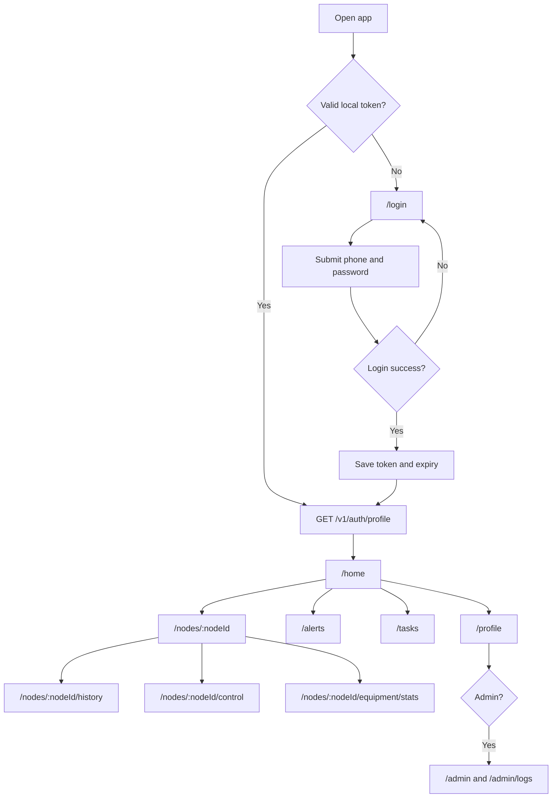

# Frontend Page Flow

本文描述当前 Vue 3 前端的路由、导航、认证跳转和页面状态。实现以 `frontend/src/router/index.ts` 为准。

## Routes

| Route | Page | Auth | Notes |
|-------|------|------|-------|
| `/login` | 登录 | No | 未登录入口 |
| `/register` | 注册 | No | 课程演示注册流程 |
| `/forgot-password` | 忘记密码 | No | 验证码重置密码 |
| `/` | Redirect | - | 重定向到 `/home` |
| `/home` | 控制台概览 | Yes | 登录后默认页 |
| `/gateway` | 网关管理 | Yes | 设备管理入口页 |
| `/nodes/:nodeId` | 节点详情 | Yes | 节点状态、元数据、告警、任务摘要 |
| `/nodes/:nodeId/templates` | 设备模板 | Yes | 固定设备类型和控制形态 |
| `/nodes/:nodeId/control` | 设备控制演示 | Yes | 前端控制面板演示，不下发真实命令 |
| `/nodes/:nodeId/realtime` | 实时数据 | Yes | 基于模拟历史接口展示近实时视图 |
| `/nodes/:nodeId/history` | 历史数据 | Yes | 传感器曲线 |
| `/nodes/:nodeId/equipment/stats` | 设备统计 | Yes | 设备统计趋势 |
| `/strategies` | 自动化策略 | Yes | 课程策略展示和任务关联 |
| `/tasks` | 任务调度 | Yes | 当前用户任务 CRUD |
| `/alerts` | 告警中心 | Yes | 告警筛选、分页和处理 |
| `/profile` | 系统设置 | Yes | 个人资料、密码、登出 |
| `/admin` | 用户管理 | Admin | 节点、用户、授权管理 |
| `/admin/logs` | 操作日志 | Admin | 日志查询 |

Compatibility redirects:

| Old Route | Redirect |
|-----------|----------|
| `/dashboard` | `/home` |
| `/nodes/:nodeId/sensors` | `/nodes/:nodeId/history` |
| `/nodes/:nodeId/equipment` | `/nodes/:nodeId/control` |

## Main Flow

## Navigation Rules

- 未登录访问需要认证的页面时，跳转 `/login?redirect=<target>`。
- 登录成功后优先回跳 `redirect`，否则进入 `/home`。
- token 过期或接口返回 `code=401` 时，清理登录态并跳转 `/login`。
- 登录用户访问 `/login`、`/register`、`/forgot-password` 时，跳转 `/home`。
- 普通用户不能进入 `/admin` 和 `/admin/logs`；管理员根据 `profile.role` 判断。
- 页面按 `nodeId` 参数实现，默认演示节点为 `SIM_Node_01`。

## Page States

| State | Rule |
|-------|------|
| `loading` | 数据请求中显示局部加载状态 |
| `empty` | 请求成功但无数据时显示空状态和可执行动作 |
| `error` | 网络错误或业务 `code != 200` 时显示错误消息和重试入口 |
| `ready` | 数据完整时展示页面主体 |

## Responsive Rules

- 首版需要能在手机浏览器查看，不要求完整移动端后台体验。
- 窄屏下导航折叠为顶部菜单或抽屉。
- 表格在窄屏下可转为列表项，避免横向溢出。
- 图表容器保持固定最小高度，切换指标时不造成布局跳动。
