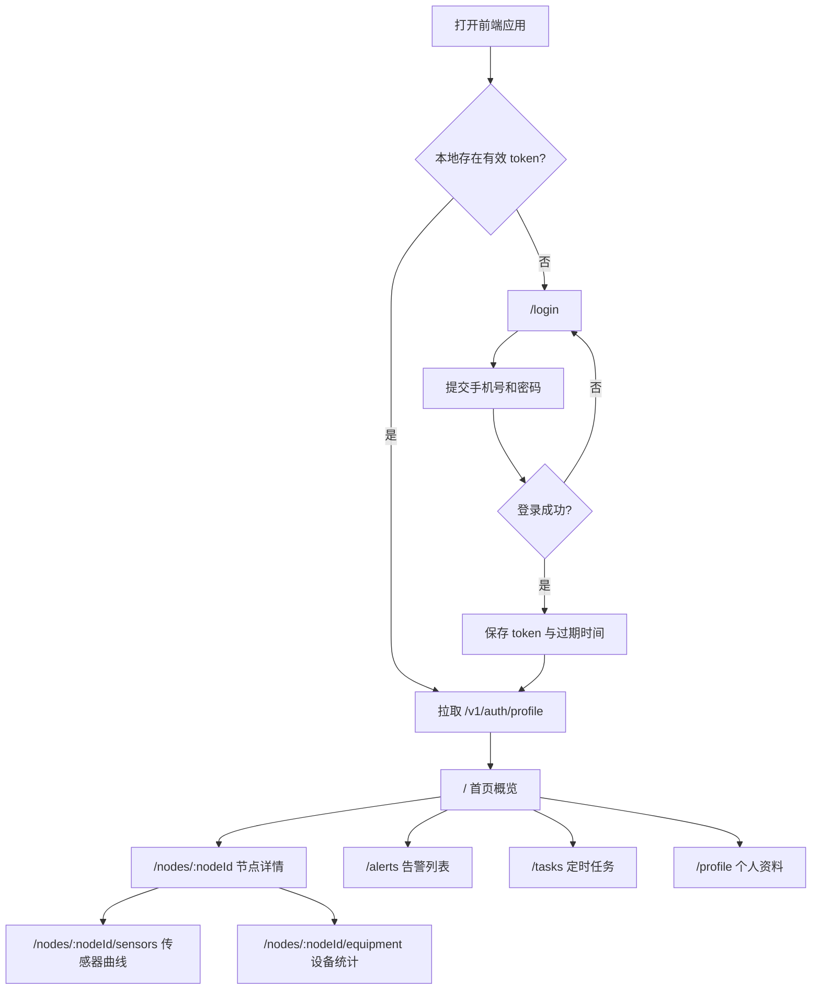

# HMHT 课程版前端页面流程

本文描述首版前端的路由、导航和页面跳转关系。页面命名以实现时可直接转化为路由为准，具体实现默认采用 Vite + Vue 3 + Vue Router。

## 路由总览

| 路由 | 页面 | 认证 | 说明 |
|------|------|------|------|
| `/login` | 登录 | 否 | 默认未登录入口 |
| `/register` | 注册 | 否 | 课程演示注册流程 |
| `/forgot-password` | 忘记密码 | 否 | 可选页面，可延后 |
| `/` | 首页概览 | 是 | 登录后默认页，展示节点和关键摘要 |
| `/nodes/:nodeId` | 节点详情 | 是 | 展示节点状态、传感器和设备元数据 |
| `/nodes/:nodeId/sensors` | 传感器曲线 | 否或是 | 后端当前不强制认证；前端建议登录后访问 |
| `/nodes/:nodeId/equipment` | 设备统计 | 否或是 | 后端当前不强制认证；前端建议登录后访问 |
| `/alerts` | 告警列表 | 否或是 | 后端当前不强制认证；前端建议登录后访问 |
| `/tasks` | 定时任务 | 是 | 当前用户任务管理 |
| `/profile` | 个人资料 | 是 | 资料修改、改密、登出 |
| `/admin` | 管理入口 | 是，管理员 | 可选二期，展示节点、用户、授权、日志 |

## 主流程

## 页面结构

| 区域 | 内容 |
|------|------|
| 应用外壳 | 顶部栏或侧边栏、当前用户、登出按钮、主内容区 |
| 首页概览 | 节点列表、未处理告警数量、常用入口、健康检查状态 |
| 节点详情 | 节点名称、状态、传感器元数据、设备元数据、阈值信息 |
| 传感器曲线 | 指标切换、时间范围切换、摘要卡片、折线图 |
| 设备统计 | 设备切换、统计摘要、趋势图或柱状图 |
| 告警列表 | 筛选条件、分页列表、处理按钮 |
| 定时任务 | 任务表格、创建/编辑弹窗、启停开关、删除确认 |
| 个人资料 | 基本资料表单、密码修改表单 |

## 导航规则

- 未登录访问需要认证的页面时，跳转 `/login`。
- 登录成功后跳转 `/`，如果有登录前目标地址，可回跳该地址。
- token 过期或接口返回 `code=401` 时，清理登录态并跳转 `/login`。
- 普通用户不显示 `/admin` 导航入口；管理员根据 `profile.role` 显示。
- 课程版固定节点为 `SIM_Node_01`，但页面仍按 `nodeId` 参数实现，便于兼容管理接口创建的演示节点。

## 页面状态

| 状态 | 展示规则 |
|------|----------|
| loading | 数据请求中展示骨架屏、加载条或局部加载状态 |
| empty | 接口成功但无数据时展示空状态和可执行动作 |
| error | 网络错误或业务 `code != 200` 时展示错误消息和重试入口 |
| ready | 数据完整时展示页面主体 |

## 移动端规则

- 首版需要能在手机浏览器查看，不要求完整移动端后台体验。
- 导航在窄屏下折叠为顶部菜单或抽屉。
- 表格在窄屏下可转为列表项，避免横向溢出。
- 图表容器保持固定最小高度，切换指标时不应造成布局跳动。
